  <picture>
    <source media="(prefers-color-scheme: dark)" srcset="./dark.svg">
    <source media="(prefers-color-scheme: light)" srcset="./light.svg">
    
  </picture>

 

  

 

  
  
  
  
  

 

  
  
  

---

## About Me

Hi, I’m **Ashutosh Prajapati** — a BCA student passionate about **Full Stack Web Development**.

I work with the **MERN Stack** (MongoDB, Express, React, Node.js) and love turning ideas into real, working web applications. I focus on writing clean code, building solid structure, and using modern **AI tools** to develop and deploy projects faster.

Currently building and deploying full-stack projects, improving my skills every day, and looking for opportunities to learn and grow as a developer.

**Open to internships and collaborations.**

---

## Tech Stack

### Languages

  

### Frontend

  

### Backend & Database

  

### Tools & Others

  

---

## Featured Project

**99+ AI / ML / DL / CV / NLP Projects with Code**  
A curated collection of practical AI, Machine Learning, Deep Learning, Computer Vision, and NLP projects with source code.

→ [View Repository](https://github.com/ashutosh9151/99_AI-ML-DL-CV-NLP-Projects-with-Code)

---

## Certifications

- **Wells Fargo** – Software Engineering Job Simulation
- **Mastercard** – Cybersecurity Job Simulation
- **British Airways** – Data Science Job Simulation
- Generative AI Skills for Creative Content
- AI Productivity Hacks

---

## Education

**Bachelor of Computer Applications (BCA)**  
Maharana Pratap Group of Institutions  
*2023 – 2026*

---

## GitHub Stats

  
  

  
  

---

  
## 🐍 Watch the snake eat my contributions

  

*⭐️ Always learning, always building.* 💗

## 🏆 GitHub Trophies

## Connect with Me

  
  
  

---

  <em>“Learning every day. Building every day.”</em>

